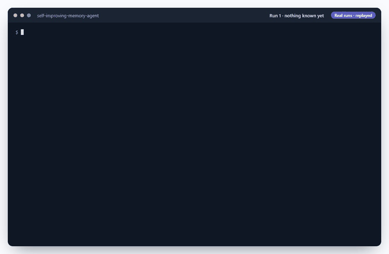

# Self-Improving Agent with Persistent Memory

[](https://github.com/usmanshah904/self-improving-memory-agent/actions/workflows/tests.yml)


A work assistant that **gets better the more you use it**. After each task, Claude decides whether the conversation
revealed something worth keeping (a **preference**, a **skill** or an **instruction**) and saves it to a small JSON
memory. On later tasks the assistant retrieves only the memories that are relevant and follows them, so you don't have
to repeat yourself. Similar memories are **consolidated** instead of piling up as duplicates.



## Demo

Run 1 states a preference once. Run 2 is a different task with no preference given: the assistant retrieves the
preference, follows it (a short answer with one real-world example), and learns a related skill, stored separately.



<sub>Terminal output replayed from real runs (the waits for Claude are shortened).</sub>

## How it works

| Step | What happens |
| --- | --- |
| **1. Retrieve** | `search_memories()` scores each memory by how many of the task's keywords it covers and returns the top 3. Filler words are ignored and word families are grouped ("explain" ≈ "explanations"), so an unrelated task retrieves nothing. |
| **2. Respond** | Claude answers the task, following the retrieved preferences, skills and instructions. Each memory used gets its use count and last-used time updated. |
| **3. Learn** | A second Claude call acts as the learning component: it returns JSON saying whether there is one reusable thing to remember, and its category. Code fences or extra text around the JSON are tolerated. |
| **4. Consolidate & save** | The new memory is merged with similar memories **of the same category**, keeping the most detailed wording, the earliest creation date and the total use count. Otherwise it is added. |

Design choices:

- **No extra dependencies.** Matching uses keyword overlap with light stemming, not embeddings, so it runs anywhere
  with the Python standard library.
- **Categories never mix.** A preference ("keep answers short") and a skill ("use an analogy, then an example") are
  kept apart even when they share words.
- **Detail is never lost.** A vaguer restatement of a memory never replaces a more detailed one.
- **Safe on failure.** If Claude is unavailable or times out, the run stops and nothing is saved. A missing or corrupt
  memory file is treated as empty.

Each memory is stored as:

```json
{
  "id": "3f9c2a1b",
  "memory": "User prefers short, beginner-friendly explanations with one simple real-world example.",
  "category": "preference",
  "created_at": "2026-10-16T09:12:40+00:00",
  "last_used_at": "2026-10-16T09:14:02+00:00",
  "use_count": 1
}
```

## Getting started

Requirements: Python 3.11+ and the [Claude Code CLI](https://code.claude.com/docs) installed and signed in
(the agent calls `claude -p`, so no API key is needed in the code). There are no Python packages to install.

```bash
git clone https://github.com/usmanshah904/self-improving-memory-agent.git
cd self-improving-memory-agent
```

### Run it

```bash
python agent.py "Explain what an API is. I prefer short answers with one real-world example."
python agent.py "Explain what a database index is."   # applies what run 1 learned
python agent.py --show-memories                       # what it has learned, with usage
```

| Option | Purpose |
| --- | --- |
| `task` (positional) | What you want help with. Asked interactively if omitted. |
| `--show-memories` | List saved memories and how often each was used. |
| `--consolidate` | Merge similar memories already in the store. |
| `--reset` | Forget everything. |
| `--memory-file PATH` | Use a different memory store. Default `memory/memories.json` (not committed). |

To see consolidation on its own, try it on the example store, which holds three near-duplicates from an early
version of the agent:

```bash
cp memory/example-memories.json demo.json
python agent.py --memory-file demo.json --consolidate   # 3 memories -> 2
```

## Tests

```bash
pip install -r requirements-dev.txt
pytest -v
```

21 offline tests, run on every push by GitHub Actions. Claude is replaced with canned replies, so they need no CLI or
network. They cover relevance search (filler words, ranking, unrelated tasks), consolidation of paraphrases, categories
never merging, detail being kept, usage metadata, corrupt files, parsing the learning JSON, the full learn-then-apply
loop across two runs, and Claude errors.

## Project structure

```
├── agent.py            # the loop: retrieve, respond, learn, save; CLI
├── memory_manager.py   # JSON store, relevance search, consolidation, usage tracking
├── memory/             # example-memories.json (your memories.json stays local)
├── tests/              # offline tests (CI)
└── docs/               # architecture diagram, demo
```

## License

[MIT](LICENSE) © 2026 Usman Shah
